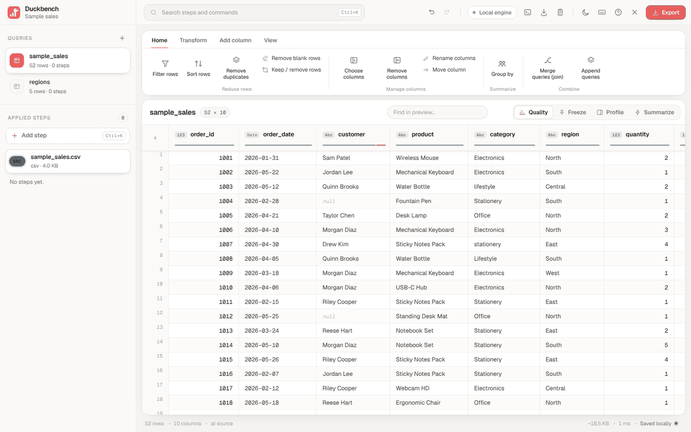

# Duckbench

A data-prep workbench that runs entirely on your machine. Clean, reshape, join and export CSV, Excel, JSON and Parquet files with visual steps or SQL. Nothing is uploaded: files are processed in the browser tab or in the desktop app.



**Try it:** https://duckbench2.vercel.app · **Desktop:** in preview, see [Desktop](#desktop), with an optional [native DuckDB build](#native-duckdb-build-windows)

Duckbench uses two engines. A fast JavaScript engine handles everyday files. [DuckDB-WASM](https://duckdb.org/docs/api/wasm/overview) handles SQL and files too large for memory.

## What it does

**Visual steps**
- Filter, sort, remove duplicates or blank rows, keep a range or sample of rows
- Choose, remove, rename, move and duplicate columns
- Change type with lenient number parsing (currency, thousands separators, %, negatives in brackets) and flexible date parsing
- Text: split, merge, extract, replace, change case, trim and clean, pad
- Numbers and dates: math, rounding, date parts, date formatting
- Formula and conditional columns, index, rank, running total, percent of total
- Group by, pivot, unpivot, transpose
- Join and append queries, with exact, loose or Arabic-aware key matching

**Working with steps**
- Every change is a step you can click to preview, edit, disable or reorder
- Undo and redo for every edit
- Each step is cached, so editing late steps doesn't recompute early ones
- Recipes save the whole pipeline as JSON and can be applied to many files in one batch
- Each step shows how many rows and columns it added or removed
- After a file opens, up to three dismissible suggestions can offer to change a text column to numbers, trim padded text, or remove blank rows. They are computed once in the background on files that are open in memory, and each one adds a normal step you can undo
- The desktop app lists your ten most recent files on the start screen and opens them in one click
- Share a query's steps as a link. The link carries the steps only, never your file or its rows
- Copy a pipeline as SQL when the file is opened with DuckDB. The copied SQL reads the file by name, so it runs in DuckDB wherever that file exists (the in-app SQL console blocks direct file reads)

**SQL**
- SQL steps run DuckDB queries against the current data and any other query
- SQL console with a highlighting editor, autocomplete, query history and a pattern library
- EXPLAIN and EXPLAIN ANALYZE with an operator timing breakdown
- Summarize panel with DuckDB `SUMMARIZE` statistics over every row

**Large files**
- CSV files up to about 1 GB are streamed into memory
- Larger files, or any file opened with "Open with DuckDB", are queried in place
- On DuckDB-backed files, most visual steps are translated to SQL and run over the whole file: filters, sorts, column changes, type changes, replace, case, trim, split, merge, date parts, index/duplicate/move columns, fill empty values, rank, running total, percent of total, extract text on text columns, group by, joins (left, inner, right, full, semi and anti), pivots and unpivots
- Steps that can't be translated exactly run on a preview of the first 1,000,000 rows. Each step shows a `duck` badge when it ran in DuckDB and a `preview` badge when it ran on the preview. Exporting a result that contains preview-only steps, or that stopped at the 1,000,000-row preview limit, asks you to confirm first.
- Full-file export to Parquet (ZSTD), CSV, JSON or JSONL

**Grid**
- Virtualised grid for millions of rows
- Frozen columns, search, column profiles and a fill-rate bar under each header
- Double-click a header to rename it or a cell to edit it

## Supported formats

| Format | Import | Export | Open with DuckDB |
|---|---|---|---|
| CSV / TSV | ✓ (delimiter and encoding detection) | ✓ | ✓ |
| Excel `.xlsx` | ✓ | ✓ | ✓ |
| Excel `.xls`, `.ods` | ✓ | — | — |
| JSON / JSONL | ✓ | ✓ | ✓ |
| Parquet | ✓ | ✓ | ✓ |

## What it does not do

- It does not upload files or call a server. The web app fetches its libraries from a CDN (see Privacy), and nothing else leaves the page.
- Excel `.xls` and `.ods` files can be imported but not exported, and cannot be opened with DuckDB.
- Some steps still run on the preview, because DuckDB would not give exactly the same answer as the JavaScript engine: extract text on columns that are not text and the `letters` mode (the two engines disagree on thousands of newly assigned Unicode letters); regular expressions that use look-around, `\s`, `\p{…}`, back-references or named groups; loose and Arabic key matching whenever any text key contains a non-ASCII character (DuckDB has no NFKD normalisation); and joins that add a match count.
- Excel exports stop at Excel's own limits of 1,048,575 data rows and 16,384 columns per sheet. Use CSV or Parquet for larger results.
- The desktop app is a preview.
- A step is never translated to SQL when SQL could give a different answer from the JavaScript engine.

## Privacy

Files never leave your device. The web app downloads DuckDB-WASM and the Parquet library from jsDelivr on first use. If you open an Excel file with DuckDB, it also downloads DuckDB's Excel extension from `extensions.duckdb.org`. DuckDB 2.0 builds for the browser do not include the Parquet and JSON extensions, so the first time a DuckDB feature needs them (reading Parquet or JSON with DuckDB, exporting Parquet or JSON with DuckDB, JSON functions in SQL) they are downloaded from the same host. No data is sent anywhere.

A share link contains a query's steps, including column names and any values typed into steps. It never contains the file or its rows.

Sessions are saved in the browser:
- Small files are stored in IndexedDB.
- Large files opened with DuckDB are remembered as file handles in Chromium-based browsers, and as private copies in the browser's own storage (OPFS) in Firefox and Safari.

## Built with

- **No framework, no build step for the web app.** Plain ES modules, a columnar `Frame` engine in a Web Worker, and self-hosted fonts.
- **DuckDB-WASM 1.33.1-dev114.0 (DuckDB 2.0.0)** for SQL and large files, loaded on demand from jsDelivr (bundled in the desktop app).
- **Native DuckDB 2.0.0** through the `duckdb` Rust crate (1.20000.2, bundled build with the Parquet and JSON extensions) in the optional native desktop build. Query results cross from Rust to the interface as JSON converted from Apache Arrow batches.
- **hyparquet 1**, **hyparquet-compressors 1** and **hyparquet-writer 0** for reading and writing Parquet, loaded from jsDelivr on first use.
- **SheetJS 0.20.3** for Excel and OpenDocument files, vendored in `vendor/`.
- **Fonts:** Geist and Geist Mono, with Instrument Sans and JetBrains Mono as fallbacks.
- **Desktop:** Tauri 2 (Rust 1.77.2 or newer) with the dialog, updater, process and window-state plugins. esbuild prepares the web files for it.

## Getting started

### Web

Duckbench is a static site with no build step. Serve the repository root with any static file server:

```bash
npx serve .
```

Then open `http://localhost:3000`.

| Page | Purpose |
|---|---|
| `index.html` | The app. `?demo` loads a sample project; `?notour` skips the tour |
| `demo.html` | Opens the sample project. Add `?theme=light` or `?tour` |
| `tests.html` | Engine self-test |
| `parity.html` | Checks that steps translated to SQL give the same results as the JavaScript engine |

To deploy on Vercel, use the "Other" framework preset with no build command. `vercel.json` sets security headers and caching, and `.vercelignore` keeps the desktop project out of web deploys.

### Desktop

The desktop app (Tauri 2) bundles every library, works offline and uses native file dialogs. Releases include a Windows installer and Linux packages (`.deb` and `.AppImage`). Large files are read directly from disk without being copied into memory.

The desktop app is in preview.

Requirements:
- Node 18+
- Rust 1.77.2+
- The [Tauri prerequisites](https://v2.tauri.app/start/prerequisites/) for your platform

```bash
cd desktop
npm install
npm run dev
npm run build
```

`npm run dev` opens a development window. `npm run build` writes installers to `desktop/src-tauri/target/release/bundle/`. See [`desktop/README.md`](desktop/README.md) for signing and releases.

#### Native DuckDB build (Windows)

A second Windows installer, **Duckbench Native**, runs DuckDB as a native engine inside the app instead of DuckDB-WASM in the web view. The interface, the visual steps, the JavaScript engine for everyday files, recipes, share links and the SQL console are the same. It is attached to a release next to the standard installer, which is unchanged, and it installs beside it with its own settings.

What the native engine changes:
- DuckDB is not limited by browser memory. It uses a work database on disk, so large sorts, joins and group-bys can spill to disk.
- Files chosen in the native Open dialog are read in place by DuckDB, with no copy and no byte-range protocol.
- Full-file exports (Parquet, CSV, JSON, JSON Lines) are written to disk by DuckDB and moved to the place you choose. The data never passes through the web view.
- A running query can be cancelled. The engine interrupts it and stays usable.
- The Parquet, JSON and Excel extensions work offline. Parquet and JSON are built in; the Excel extension is bundled with the installer.

What it does not change or does not do:
- It is Windows only. There is no macOS or Linux build of the native engine, and no auto-update.
- The installer is unsigned, so Windows SmartScreen shows a warning.
- DuckDB runs inside the app process, with your user's file permissions. SQL steps are checked by the app before they reach DuckDB (read-only statements, no file functions), as in the web build. The native engine adds no second sandbox.
- Results and the grid are the same as in the standard build. Timestamps keep millisecond precision and decimals arrive as numbers, to match the web engine.

Build it yourself with Rust 1.88 or newer (the `duckdb` crate needs it):

```bash
cd desktop
npm install
npm run build:native
npm run check:native
```

`build:native` compiles DuckDB from source, which takes several minutes on the first run. See [`desktop/README.md`](desktop/README.md) for how it is built, tested and attached to a release.

## Keyboard shortcuts

| Shortcut | Action |
|---|---|
| `⌘K` / `Ctrl K` | Command palette and add step |
| `⌘J` / `Ctrl J` | SQL console |
| `⌘Z` / `⌘⇧Z` | Undo / redo |
| `⌘S` | Save recipe |
| `?` | All shortcuts |

## Architecture

- **No framework.** Plain ES modules, self-hosted fonts.
- **JavaScript engine** (`js/core/`, `js/engine/engine.js`)
  - A columnar `Frame` engine running in a Web Worker
  - Every step's output is cached under a hash of the steps before it
- **DuckDB layer** (`js/engine/duck.js`, `js/app/sqlrunner.js`)
  - Loads DuckDB-WASM on demand and opens a work database in OPFS when available
  - Copies data into DuckDB tables only when a query needs them
  - Converts Arrow results back to columns
- **Step compiler** (`js/engine/compile.js`, `js/engine/compile-sql.js`)
  - Translates visual steps into a single SQL plan
  - Some steps first run a small check query against the data
  - A step is never translated when SQL could give a different answer from the JavaScript engine
- **Desktop shell** (`desktop/src-tauri/`)
  - Atomic file saves, and batch exports that never overwrite
  - A local file protocol that lets DuckDB read large files directly from disk
  - Remembered window size
  - The updater plugin is installed but not called, because the release signing keys are not set up yet

## Project structure

```
index.html            app
css/app.css           styles
js/core/              types, CSV parser, frame, formulas, transforms
js/engine/            worker engine, DuckDB layer, step compiler, Parquet
js/app/               app shell, store, SQL runner, file storage, tour
js/ui/                grid, forms, SQL editor, overlays, icons
js/io/                Excel worker core, ZIP
js/tests/             self-test and parity suites
vendor/               SheetJS
fonts/                Geist, Geist Mono (+ Instrument Sans, JetBrains Mono fallbacks)
desktop/              Tauri 2 project (src-tauri/src/native/ is the native DuckDB engine)
```

## Testing

Open `tests.html` to run the engine self-test, and `parity.html` to compare SQL-translated steps against the JavaScript engine on real DuckDB-WASM. Desktop Rust tests run with:

```bash
cd desktop && cargo test --manifest-path src-tauri/Cargo.toml
```

The native engine has its own tests, which run against the real DuckDB:

```bash
cd desktop && npm run check:native
```

They cover the JavaScript adapter (`desktop/scripts/native-adapter.test.mjs`, run with a mocked Tauri bridge) and the Rust engine: value conversion, large results, truncation, registered files, exports, cancel, concurrent queries and the Excel extension.

## Roadmap

- Match counts in joins, in SQL
- Open `.xls` and `.ods` files with DuckDB

## Upgrading DuckDB-WASM

The DuckDB-WASM version is pinned in several places that must change together:

- `js/engine/libs.js`: the jsDelivr URL, and `duckBundles()` for the desktop build (the bundle names depend on the package: 1.x ships `mvp` and `eh`, the 2.0 builds ship a single `base` bundle)
- `js/engine/duck.js`: `DUCKDB_VERSION`
- `desktop/package.json` and `desktop/package-lock.json`
- `desktop/scripts/prepare.mjs`: the DuckDB core version used for the bundled Excel extension, and the bundle file names
- `.github/workflows/ci.yml` and `release.yml`: the check that the Excel extension was bundled

After changing them, open `parity.html` against the new engine (every case must pass), run the large-file flow with a CSV, a Parquet and an XLSX file, and open the SQL console. The npm package version and the DuckDB core version differ. Read the core version from the engine pill in the app. Extension files must exist at `https://extensions.duckdb.org/v<core version>/wasm_eh/<name>.duckdb_extension.wasm`.

## License

MIT. See `LICENSE`. Bundled third-party components keep their own licences.
